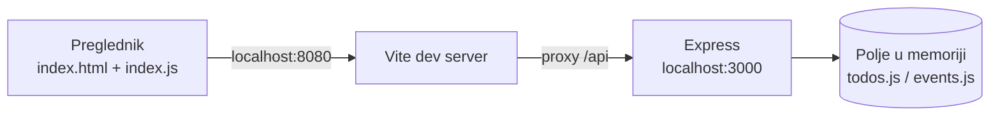
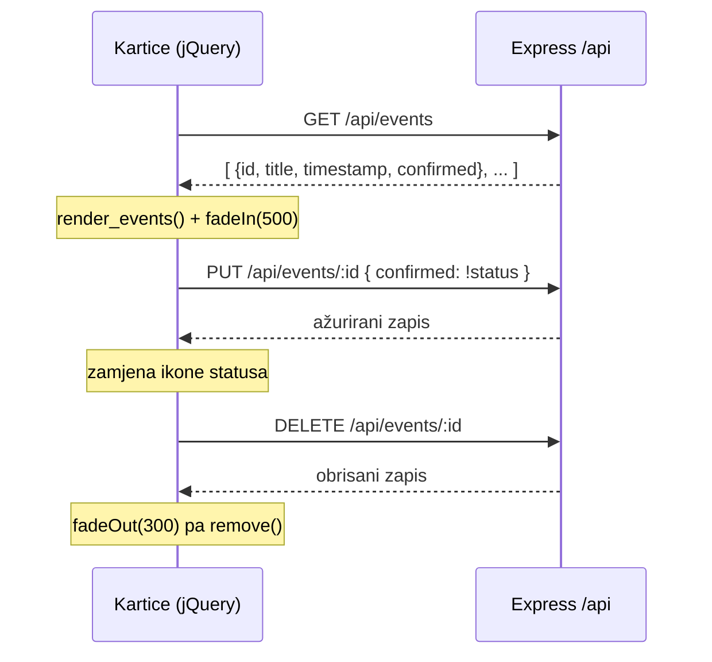

# Priprema za kolokvij: Web programiranje

Dvije probne pripreme za kolokvij s riješenim zadacima i objašnjenjima. Obje su ista vrsta aplikacije: **Express REST API** na poslužitelju i **Vite + Bootstrap 5 + Sass + jQuery** na klijentu. Razlikuju se samo podaci, boje, font i ikone.

`Node.js` · `Express 5` · `Vite` · `Bootstrap 5.3` · `Sass` · `jQuery` · `Bootstrap Icons`

> Kliknite na bilo koji **▶ Zadatak** da otvorite rješenje i objašnjenje.

## Sadržaj

- [Struktura repozitorija](#struktura-repozitorija)
- [Arhitektura](#arhitektura)
- [Pokretanje](#pokretanje)
- [Usporedba priprema](#usporedba-priprema)
- [Bodovanje](#bodovanje)
- [Probni kolokvij 1: TaskProgress](#probni-kolokvij-1-taskprogress)
- [Probni kolokvij 2: EventPulse](#probni-kolokvij-2-eventpulse)
- [Provjera prije predaje](#provjera-prije-predaje)

## Struktura repozitorija

```text
priprema za web/
├── template_kol/                     ← Probni kolokvij 1 (TaskProgress, todos)
│   ├── probni-kolokvij.pdf           tekst zadatka
│   ├── objasnjenje.html              objašnjenje rješenja (i .pdf verzija)
│   ├── capture.mp4                   snimka kako gotova aplikacija izgleda
│   └── template/                     RIJEŠEN projekt
│       ├── server/  (index.js, todos.js)
│       └── src/     (index.html, js/index.js, scss/style.scss)
│
└── pripreme za web/                  ← Probni kolokvij 2 (EventPulse, events)
    ├── probni-kolokvij-2.html        tekst zadatka
    ├── objasnjenje_rjesenja.html     objašnjenje rješenja
    ├── template/                     predložak s TODO komentarima (za vježbu)
    └── rjesenje/                     RIJEŠEN projekt
        ├── server/  (index.js, events.js)
        └── src/     (index.html, js/index.js, scss/style.scss)
```

| | Zadatak | Predložak | Rješenje | Objašnjenje |
|---|---|---|---|---|
| **Kolokvij 1** | [probni-kolokvij.pdf](template_kol/probni-kolokvij.pdf) | nema (dostupno samo rješenje) | [template_kol/template](template_kol/template) | [objasnjenje.html](template_kol/objasnjenje.html) · [PDF](template_kol/objasnjenje_rjesenja.pdf) · [video](template_kol/capture.mp4) |
| **Kolokvij 2** | [probni-kolokvij-2.html](pripreme%20za%20web/probni-kolokvij-2.html) | [template](pripreme%20za%20web/template) | [rjesenje](pripreme%20za%20web/rjesenje) | [objasnjenje_rjesenja.html](pripreme%20za%20web/objasnjenje_rjesenja.html) |

> Za vježbu: otvorite `pripreme za web/template`, riješite TODO komentare pa usporedite s `rjesenje/`.

## Arhitektura



Tok podataka na klijentu:



Vite proxy (`vite.config.js`) prosljeđuje svaki zahtjev na `/api` prema Expressu, pa klijent piše samo `$.get("/api/events")` bez porta i bez CORS-a:

```js
server: {
  port: 8080,
  proxy: { "/api": "http://localhost:3000" }
}
```

Podaci žive **samo u memoriji**. Restart servera vraća početno stanje i generira nove UUID-ove.

## Pokretanje

Potrebna su **dva terminala**. Primjer za kolokvij 2 (za kolokvij 1 zamijenite putanju s `template_kol/template`):

```bash
# Terminal 1: poslužitelj (port 3000)
cd "pripreme za web/rjesenje/server"
npm install
npm run nodemon        # ili: node index.js

# Terminal 2: klijent (port 8080)
cd "pripreme za web/rjesenje"
npm install
npm run vite
```

Otvorite http://localhost:8080.

## Usporedba priprema

Kod je gotovo identičan. Na kolokviju se mijenja samo ovo:

| | Kolokvij 1 | Kolokvij 2 |
|---|---|---|
| Aplikacija | **TaskProgress** | **EventPulse** |
| Podaci | `server/todos.js` | `server/events.js` |
| Polje statusa | `done` | `confirmed` |
| API ruta | `/api/todos` | `/api/events` |
| `$success` / `$warning` / `$danger` | `#3cb47c` / `#ffea63` / `#fe604e` | `#2ec4b6` / `#ff9f1c` / `#e71d36` |
| `$primary` | `#26a69a` | `#4361ee` |
| Font | Fraunces (serif) | Outfit (sans-serif) |
| Navbar | `bg-success`, ikona `bi-stack` | `bg-primary`, ikona `bi-calendar-event` |
| Ikona "da" | `bi-check-circle-fill text-success` | `bi-calendar-check-fill text-success` |
| Ikona "ne" | `bi-x-circle-fill text-danger` | `bi-calendar-x-fill text-danger` |
| Funkcije | `get_todos`, `render_todos` | `get_events`, `render_events` |
| Kontejner | `#todos-container` | `#events-container` |
| Zajedničko | `format_date`, `toggle`, `remove` | `format_date`, `toggle`, `remove` |

## Bodovanje

Isto za oba kolokvija:

| Zadatak | Bodovi | Što se boduje |
|---|---|---|
| Zadatak 1 | 21 | Sass boje (1), font (2), navbar (4), UUID (2), uvoz u `index.js` (2), GET (1), PUT (3), DELETE (3), klijentski `get_*` (3) |
| Zadatak 2 | 16 | sadržaj kartice (6), stil kartice i gumbi (4), responzivna mreža i razmaci (6) |
| Zadatak 3 | 22 | `render_*` (5), `toggle` (2), `remove` (2), event listeneri (4), zamjena ikone (2), `format_date` (2), fade-in (5) |
| Urednost | 1 | uklonjene sve `node_modules` mape prije zipanja |
| **Ukupno** | **60** | prag prolaza **30** (50 %) |

> **Pazite:** projekt koji se ne pokreće, promijenjena struktura mapa ili funkcija koja baca grešku = 0 bodova za taj dio. Neispravan kod **zakomentirajte**.

---

## Probni kolokvij 1: TaskProgress

Lista zadataka (todo). Kartica prikazuje naslov, datum, status (`done`) i gumbe **Toggle** i **Remove**.
Rješenje: [`template_kol/template`](template_kol/template)

<details>
<summary><b>Zadatak 1 (21 bod): Sass, navbar, server rute, <code>get_todos</code></b></summary>

#### 1a. Bootstrap boje i font: `src/scss/style.scss`

```scss
$primary: #26a69a;
$light: #f8f9fa;
$dark: #212529;
$success: #3cb47c;
$warning: #ffea63;
$danger: #fe604e;

@import "bootstrap/scss/bootstrap";

@import url('https://fonts.googleapis.com/css2?family=Fraunces:ital,opsz,wght@0,9..144,100..900;1,9..144,100..900&display=swap');
@import url("https://cdn.jsdelivr.net/npm/bootstrap-icons@1.13.2/font/bootstrap-icons.min.css");

body {
  font-family: "Fraunces", serif;
}
```

**Zašto:** Bootstrap varijable imaju `!default`, pa vrijede samo ako su definirane **prije** `@import "bootstrap/..."`. Ako ih stavite poslije, boje se neće promijeniti.

#### 1b. Navigacijska traka: `src/index.html`

```html
<nav class="navbar bg-success shadow mb-4">
    <div class="container">
        <a class="navbar-brand text-white d-flex align-items-center" href="#">
            <i class="bi bi-stack text-warning me-2 fs-5"></i>
            <span>TaskProgress</span>
        </a>
    </div>
</nav>
```

#### 1c. UUID i izvoz: `server/todos.js`

```js
import { randomUUID } from "crypto";

const todos = [
  { id: randomUUID(), title: "Buy groceries", timestamp: 1764845228329, done: true },
  // ... svaki zapis dobiva id: randomUUID()
];

export { todos };
export default todos;
```

**Zašto:** bez jedinstvenog `id`-a server ne zna koji zapis treba urediti ili obrisati. `crypto` je ugrađen u Node pa ne treba `npm install`.

#### 1d. Rute: `server/index.js`

```js
import todos from './todos.js'
app.use(express.json());

app.get("/api/todos", (req, res) => res.json(todos));

app.put("/api/todos/:id", (req, res) => {
    const todo = todos.find((t) => t.id === req.params.id);
    if (!todo) return res.status(404).json({ error: "Todo not found" });
    if (req.body.done !== undefined) todo.done = req.body.done;
    return res.json(todo);
});

app.delete("/api/todos/:id", (req, res) => {
    const index = todos.findIndex((t) => t.id === req.params.id);
    if (index === -1) return res.status(404).json({ error: "Todo not found" });
    const [removed] = todos.splice(index, 1);
    return res.json(removed);
});
```

**Zašto:** `express.json()` parsira JSON tijelo PUT zahtjeva. Bez njega je `req.body` prazan i `toggle` ništa ne mijenja.

#### 1e. Klijent: `get_todos` u `src/js/index.js`

```js
function get_todos(callback) {
    const request = $.get("/api/todos");
    if (typeof callback === "function") request.then(callback);
    return request;   // vraća jQuery Promise
}
```

</details>

<details>
<summary><b>Zadatak 2 (16 bodova): prototip kartice i responzivna mreža</b></summary>

```html
<div class="row row-cols-1 row-cols-md-2 row-cols-lg-3 g-4">
    <div class="col">
        <div class="card rounded-4 border shadow-sm p-3 h-100">
            <div class="card-body d-flex flex-column justify-content-between p-0">
                <div>
                    <h5 class="card-title fw-bold mb-2">Buy groceries</h5>
                    <p class="card-text mb-1"><span class="fw-bold">When:</span> 12/4/2025</p>
                    <p class="card-text mb-3"><span class="fw-bold">Status:</span> <i class="bi bi-check-circle-fill text-success"></i></p>
                </div>
                <div class="d-flex gap-2 mt-auto">
                    <button class="btn btn-outline-secondary rounded-pill flex-fill">Toggle</button>
                    <button class="btn btn-outline-secondary rounded-pill flex-fill">Remove</button>
                </div>
            </div>
        </div>
    </div>
</div>
```

| Klasa | Što radi |
|---|---|
| `row-cols-1 row-cols-md-2 row-cols-lg-3` | 1 stupac na mobitelu, 2 na tabletu, 3 na desktopu |
| `g-4` | razmak (gutter) između kartica |
| `rounded-4 border shadow-sm` | zaobljenost, tanki obrub, mala sjena |
| `h-100` | sve kartice u redu iste visine |
| `d-flex gap-2 mt-auto` | gumbi vodoravno, s razmakom, prikliješteni na dno |
| `rounded-pill flex-fill` | gumbi u obliku pilule koji dijele širinu |

Nakon izrade prototip se **zakomentira**, a ostaje prazan kontejner u koji JS iscrtava kartice:

```html
<div id="todos-container" class="row row-cols-1 row-cols-md-2 row-cols-lg-3 g-4 w-100"></div>
```

</details>

<details>
<summary><b>Zadatak 3 (22 boda): <code>render_todos</code>, <code>toggle</code>, <code>remove</code>, <code>format_date</code></b></summary>

Kod je **isti kao u kolokviju 2** (puni kod s objašnjenjem: [Kolokvij 2, Zadatak 3](#probni-kolokvij-2-eventpulse)). Razlike su samo u imenima:

| Kolokvij 1 | umjesto (Kolokvij 2) |
|---|---|
| `get_todos()` → `$.get("/api/todos")` | `get_events()` → `$.get("/api/events")` |
| `render_todos(todos)` u `#todos-container` | `render_events(events)` u `#events-container` |
| `JSON.stringify({ done: newStatus })` | `JSON.stringify({ confirmed: newStatus })` |
| `bi-check-circle-fill` ↔ `bi-x-circle-fill` | `bi-calendar-check-fill` ↔ `bi-calendar-x-fill` |

Izvor: [`template_kol/template/src/js/index.js`](template_kol/template/src/js/index.js)

</details>

---

## Probni kolokvij 2: EventPulse

Praćenje događaja. Kartica prikazuje naslov, datum, status potvrde (`confirmed`) i gumbe **Toggle** i **Remove**.
Predložak: [`pripreme za web/template`](pripreme%20za%20web/template) · Rješenje: [`pripreme za web/rjesenje`](pripreme%20za%20web/rjesenje)

<details>
<summary><b>Zadatak 1 (21 bod): Sass, navbar, server rute, <code>get_events</code></b></summary>

#### 1a. Boje i font Outfit: `src/scss/style.scss` (1 + 2 boda)

```scss
$primary: #4361ee;
$light: #f8f9fa;
$dark: #212529;
$success: #2ec4b6;
$warning: #ff9f1c;
$danger: #e71d36;

@import "bootstrap/scss/bootstrap";

@import url('https://fonts.googleapis.com/css2?family=Outfit:wght@300;400;500;600;700&display=swap');
@import url("https://cdn.jsdelivr.net/npm/bootstrap-icons@1.13.2/font/bootstrap-icons.min.css");

body {
  font-family: "Outfit", sans-serif;
}
```

#### 1b. Navbar: `src/index.html` (4 boda)

```html
<nav class="navbar bg-primary shadow mb-4">
    <div class="container">
        <a class="navbar-brand text-white d-flex align-items-center" href="#">
            <i class="bi bi-calendar-event text-warning me-2 fs-5"></i>
            <span>EventPulse</span>
        </a>
    </div>
</nav>
```

#### 1c. UUID i izvoz: `server/events.js` (2 boda)

```js
import { randomUUID } from "crypto";

const events = [
  { id: randomUUID(), title: "Web Dev Workshop", timestamp: 1765018057945, confirmed: true },
  // ... svaki zapis dobiva id: randomUUID()
];

export { events };
export default events;
```

#### 1d. Uvoz i rute: `server/index.js` (2 + 1 + 3 + 3 boda)

```js
import express from 'express'
import events from './events.js'

const app = express()
app.use(express.json());

// GET: svi zapisi (1 bod)
app.get("/api/events", (req, res) => {
    res.json(events);
});

// PUT: uređivanje (3 boda)
const updateEvent = (req, res) => {
    const { id } = req.params;
    const item = events.find((e) => e.id === id);
    if (!item) {
        return res.status(404).json({ error: "Event not found" });
    }
    if (req.body.confirmed !== undefined) item.confirmed = req.body.confirmed;
    if (req.body.title !== undefined)     item.title = req.body.title;
    if (req.body.timestamp !== undefined) item.timestamp = req.body.timestamp;
    return res.json(item);
};
app.put("/api/events/:id", updateEvent);
app.patch("/api/events/:id", updateEvent);

// DELETE: brisanje (3 boda)
const deleteEvent = (req, res) => {
    const { id } = req.params;
    const index = events.findIndex((e) => e.id === id);
    if (index === -1) {
        return res.status(404).json({ error: "Event not found" });
    }
    const [removed] = events.splice(index, 1);
    return res.json(removed);
};
app.delete("/api/events/:id", deleteEvent);
```

| Metoda | Ruta | Tijelo | Odgovor |
|---|---|---|---|
| `GET` | `/api/events` | | polje svih događaja |
| `PUT` / `PATCH` | `/api/events/:id` | `{ "confirmed": true }` | ažurirani događaj ili `404` |
| `DELETE` | `/api/events/:id` | | obrisani događaj ili `404` |

**Zašto:** `find` vraća referencu na objekt u polju, pa izmjena `item.confirmed` mijenja i originalno polje. `splice` stvarno uklanja element iz polja, dok `filter` vraća novo polje i original ostaje isti.

#### 1e. Klijent: `get_events` (3 boda)

```js
function get_events(callback) {
    const request = $.get("/api/events");
    if (typeof callback === "function") {
        request.then(callback);
    }
    return request;
}
```

</details>

<details>
<summary><b>Zadatak 2 (16 bodova): prototip kartice i responzivna mreža</b></summary>

```html
<!-- Prototip kartice (Zadatak 2):
<div class="row row-cols-1 row-cols-md-2 row-cols-lg-3 g-4">
    <div class="col">
        <div class="card rounded-4 border shadow-sm p-3 h-100">
            <div class="card-body d-flex flex-column justify-content-between p-0">
                <div>
                    <h5 class="card-title fw-bold mb-2">Web Dev Workshop</h5>
                    <p class="card-text mb-1"><span class="fw-bold">When:</span> 12/6/2025</p>
                    <p class="card-text mb-3"><span class="fw-bold">Status:</span> <i class="bi bi-calendar-check-fill text-success"></i></p>
                </div>
                <div class="d-flex gap-2 mt-auto">
                    <button class="btn btn-outline-secondary rounded-pill flex-fill">Toggle</button>
                    <button class="btn btn-outline-secondary rounded-pill flex-fill">Remove</button>
                </div>
            </div>
        </div>
    </div>
</div>
-->

<div id="events-container" class="row row-cols-1 row-cols-md-2 row-cols-lg-3 g-4 w-100"></div>
```

| Stavka | Bodovi |
|---|---|
| naslov, datum `When: M/D/YYYY`, status s ikonom, gumbi Toggle i Remove | 1 + 1 + 2 + 2 |
| `rounded-4 border shadow-sm` | 1 |
| `btn btn-outline-secondary rounded-pill flex-fill` | 3 |
| mreža 1/2/3 stupca (`row-cols-1 row-cols-md-2 row-cols-lg-3`) | 2 |
| gumbi vodoravno s razmakom na dnu (`d-flex gap-2 mt-auto`) | 2 |
| razmaci između kartica `g-4` | 2 |

Status: `calendar-check-fill text-success` = potvrđeno, `calendar-x-fill text-danger` = nije potvrđeno.

</details>

<details>
<summary><b>Zadatak 3 (22 boda): <code>render_events</code>, <code>toggle</code>, <code>remove</code>, <code>format_date</code>, animacije</b></summary>

Sve je u [`rjesenje/src/js/index.js`](pripreme%20za%20web/rjesenje/src/js/index.js).

#### `format_date` (2 boda): Unix milisekunde u `M/D/YYYY`

```js
function format_date(timestamp) {
    const d = new Date(timestamp);
    return `${d.getMonth() + 1}/${d.getDate()}/${d.getFullYear()}`;
}
// format_date(1765018057945) → "12/6/2025"
```

`getMonth()` vraća 0–11, zato `+ 1`. `getDate()` je dan u mjesecu, a `getDay()` bi vratio dan u tjednu, što je česta greška.

#### `render_events` (5 bodova) + fade-in 500 ms (5 bodova) + listeneri (4 boda)

```js
function render_events(events) {
    const $container = $("#events-container");
    $container.empty();

    events.forEach((item) => {
        const formattedDate = format_date(item.timestamp);
        const iconClass = item.confirmed
            ? "bi-calendar-check-fill text-success"
            : "bi-calendar-x-fill text-danger";

        const $col = $(`
            <div class="col" data-id="${item.id}">
                <div class="card rounded-4 border shadow-sm p-3 h-100">
                    <div class="card-body d-flex flex-column justify-content-between p-0">
                        <div>
                            <h5 class="card-title fw-bold mb-2">${item.title}</h5>
                            <p class="card-text mb-1"><span class="fw-bold">When:</span> ${formattedDate}</p>
                            <p class="card-text mb-3"><span class="fw-bold">Status:</span> <i class="bi ${iconClass} status-icon"></i></p>
                        </div>
                        <div class="d-flex gap-2 mt-auto">
                            <button class="btn btn-outline-secondary rounded-pill flex-fill btn-toggle">Toggle</button>
                            <button class="btn btn-outline-secondary rounded-pill flex-fill btn-remove">Remove</button>
                        </div>
                    </div>
                </div>
            </div>
        `);

        $col.find(".btn-toggle").on("click", () => toggle(item.id));
        $col.find(".btn-remove").on("click", () => remove(item.id));

        $col.hide();
        $container.append($col);
        $col.fadeIn(500);
    });
}
```

**Zašto ovako:**
- Zakomentirani prototip iz Zadatka 2 postaje template string, a vrijednosti se umeću s `${...}`.
- `data-id` na stupcu omogućuje da `toggle` i `remove` kasnije pronađu baš tu karticu.
- Listener se veže na `$col.find(...)` dok je kartica još u varijabli, pa svaki gumb zna svoj `item.id`.
- `hide()` → `append()` → `fadeIn(500)`: element mora biti skriven prije nego što se može postupno pojaviti.

#### `toggle` (2 boda) + zamjena ikone (2 boda)

```js
function toggle(id) {
    const $col = $(`[data-id="${id}"]`);
    const $statusIcon = $col.find(".status-icon");
    const isConfirmed = $statusIcon.hasClass("bi-calendar-check-fill");
    const newStatus = !isConfirmed;

    return $.ajax({
        url: `/api/events/${id}`,
        method: "PUT",
        contentType: "application/json",
        data: JSON.stringify({ confirmed: newStatus }),
        success: (updated) => {
            if (updated.confirmed) {
                $statusIcon
                    .removeClass("bi-calendar-x-fill text-danger")
                    .addClass("bi-calendar-check-fill text-success");
            } else {
                $statusIcon
                    .removeClass("bi-calendar-check-fill text-success")
                    .addClass("bi-calendar-x-fill text-danger");
            }
        },
        error: (err) => console.error("Greška pri ažuriranju statusa:", err)
    });
}
```

`$.get`/`$.post` ne podržavaju PUT, pa se koristi `$.ajax`. `contentType: "application/json"` i `JSON.stringify` su nužni da ga `express.json()` na serveru pročita. Ikona se mijenja tek u `success`, nakon što server potvrdi promjenu, pa se klijent i server ne mogu razići.

#### `remove` (2 boda) + fade-out 300 ms

```js
function remove(id) {
    const $col = $(`[data-id="${id}"]`);
    return $.ajax({
        url: `/api/events/${id}`,
        method: "DELETE",
        success: () => {
            $col.fadeOut(300, function () {
                $(this).remove();
            });
        },
        error: (err) => console.error("Greška pri brisanju zapisa:", err)
    });
}
```

`remove()` se poziva u callbacku od `fadeOut`, inače bi element nestao prije kraja animacije.

#### Izlaganje funkcija i inicijalno učitavanje

```js
window.format_date = format_date;
window.get_events = get_events;
window.toggle = toggle;
window.remove = remove;
window.render_events = render_events;

$(() => {
    get_events().then((events) => {
        render_events(events);
    });
});
```

`index.js` je ES modul (`type="module"`), pa njegove funkcije nisu globalne. Bez `window.*` ih testovi i konzola preglednika ne vide.

</details>

---

## Provjera prije predaje

- [ ] Sass varijable boja su **iznad** `@import "bootstrap/scss/bootstrap"`
- [ ] Font je uvezen i postavljen na `body`
- [ ] `events.js` / `todos.js`: `randomUUID` uvezen, svaki zapis ima `id`, oba exporta (`export { … }` i `export default`)
- [ ] `server/index.js`: `import`, `app.use(express.json())`, rute GET, PUT i DELETE
- [ ] Prototip kartice u `index.html` je **zakomentiran**, kontejner `#…-container` postoji
- [ ] Sve funkcije su na `window` i ne bacaju grešku (neispravan kod zakomentirati!)
- [ ] Toggle mijenja ikonu, Remove radi fade-out, kartice se pojavljuju s fade-in
- [ ] Obje aplikacije se pokreću (`npm run nodemon` + `npm run vite`)
- [ ] Obrisane **sve** `node_modules` mape (1 bod)
- [ ] Zip nazvan `prezime_ime_kolokvij_2.zip` i poslan na Teams
